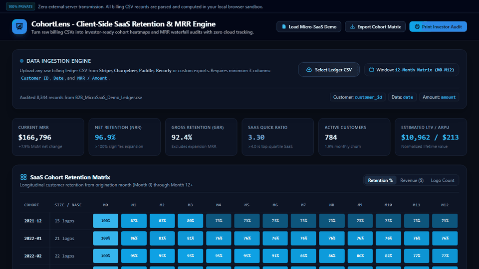
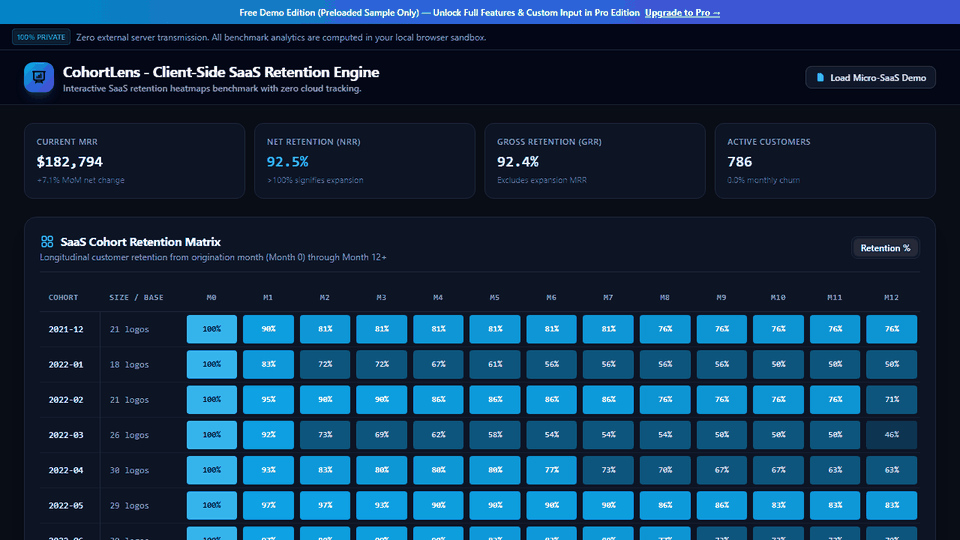

# CohortLens - Client-Side SaaS Retention & MRR Engine

Turn raw billing CSVs into investor-ready cohort heatmaps and MRR waterfall audits with zero cloud tracking.

## Full Pro Edition Preview

Get the complete offline tool: [CohortLens Full Pro Edition](https://bobservice.gumroad.com/l/cohortlens-client-side-saas-retention-mrr-engine?utm_source=github)

---

## Free Live Demo Preview

Test the interactive web version: [Try the Free Live Demo](https://nexusmedialab04-art.github.io/cohortlens-client-side-saas-retention-mrr-engine/)

---

## Feature Comparison

| Feature / Capability | Free Demo | Full Pro Edition |
| :--- | :---: | :---: |
| **Execution Architecture** | 100% Client-Side | 100% Client-Side |
| **Zero Cloud Data Leakage** | Yes | Yes |
| **Load Micro-SaaS Demo** | Yes | Yes |
| **Retention % Toggle** | Yes | Yes |
| **Revenue ($) Toggle** | No | Yes |
| **Logo Count Toggle** | No | Yes |
| **Data Ingestion Engine (File Input)** | 0 | 1 |
| **Export Cohort Matrix** | No | Yes |
| **Print Investor Audit** | No | Yes |
| **SaaS Cohort Retention Matrix** | Yes | Yes |
| **MRR Movement Waterfall** | No | Yes |
| **Retention Decay Curve by Vintage** | No | Yes |
| **M&A / Fractional CFO Due Diligence Audit Findings** | No | Yes |
| **Technical Guide & Legal Disclaimer** | Yes | Yes |

---

## Technical Overview

CohortLens runs entirely inside the browser DOM. No raw billing records or subscription ledgers are uploaded to external analytics backends. 

### Core Sections
- **Data Ingestion Engine**: Accepts raw transaction ledgers locally.
- **SaaS Cohort Retention Matrix**: Displays retention metrics across monthly vintages.
- **MRR Movement Waterfall**: Tracks financial expansion, contraction, churn, and reactivation metrics.
- **Retention Decay Curve by Vintage**: Provides graphical insight into subscriber lifetime trends.
- **M&A / Fractional CFO Due Diligence Audit Findings**: Summarizes core SaaS health metrics for audit compliance.

---

## Usage

1. Open `index_pro.html` or `index_lite.html` directly in your browser.
2. Use **Load Micro-SaaS Demo** to test sample metric rendering.
3. In the Pro Edition, load your billing file using the **Data Ingestion Engine** input.
4. Toggle between **Retention %**, **Revenue ($)**, and **Logo Count** views.
5. Use **Export Cohort Matrix** or **Print Investor Audit** to capture reported output.
===GITHUB_README===